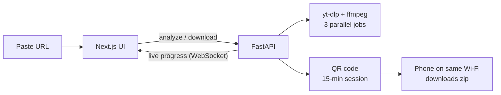

<h1 align="center">⚡ PulseGrab</h1>

<p align="center">Grab videos or mp3s from YouTube and 1,800+ sites — then beam them to your phone with a QR code. All local.</p>

<p align="center">
  
  
  
</p>

> **Showcase repo.** The layout, routes, types and UI shell are real, but the function bodies are
> **stubbed** (`NotImplementedError`). It runs, but downloads and transfers won't work. The working
> implementation is private. [Why →](#status--known-issues)

## Why it's different

| Feature | What it means |
|---|---|
| **Parallel playlists** | Pulls 3 videos at once, plus parallel fragments inside each video. About 3× faster on a 20-video playlist. |
| **Live throughput** | Shows per-item speed and ETA, plus the combined speed of the whole job. |
| **Fake-playlist guard** | Warns before downloading a page's preview clips instead of the real video. This was a real bug found during testing. |
| **Phone transfer** | Scan a QR code, the file goes straight over your Wi-Fi as one zip. No app, account or internet needed. |
| **Any site** | Every yt-dlp site works the same way, video or audio. |

## How it works



## Quick start

Needs Python 3.10+, Node 18+ and `ffmpeg` on your PATH.

```bash
npm start            # starts backend :8000 + frontend :3000 (or run.ps1 / run.bat)
```

The UI and every API route respond. Routes that would do real work return a clear
"not implemented in the public version" error.

<details>
<summary><b>API, configuration and phone tips</b></summary>

| Method | Path | Purpose |
|---|---|---|
| `POST` | `/api/analyze` | Metadata, playlist detection, fake-playlist warning |
| `POST` | `/api/download` | Start a job, returns `job_id` |
| `GET` · `WS` | `/api/jobs/{id}` · `/ws/jobs/{id}` | Poll or stream progress |
| `GET` · `DELETE` | `/api/library[/{file}]` | List or delete finished files |
| `POST` | `/api/transfer` | Create a 15-minute QR transfer session |
| `GET` | `/transfer/{session}[/zip]` | Phone page; one-tap zip |

**Config:** `CONCURRENT_PLAYLIST_DOWNLOADS` (3), `CONCURRENT_FRAGMENT_DOWNLOADS` (4), `SESSION_TTL_SECONDS` (900),
audio 320/192/128 kbps, video best/1080/720/480. All are set in `backend/`.

**Phone:** Android music apps index `Downloads`/`Music`. On iPhone, files land in the Files app; use VLC for iOS to build playlists.
</details>

## Status & known issues

| | |
|---|---|
| **Public repo** | Logic is intentionally stubbed, so the architecture is visible without publishing the implementation |
| **State** | Jobs and transfer sessions live in memory and are lost on restart (single-user local tool) |
| **iOS** | No web app can write into Apple Music; files go to the Files app |
| **Phone transfer** | mp3s only, by design; videos stay on the computer |
| **Legal** | yt-dlp is legal, but downloading from YouTube is against its Terms of Service. For personal, Creative Commons or own content only. |

## Roadmap

- [ ] Persist job history (SQLite)
- [ ] Optional video transfer to phone
- [ ] Packaged desktop build (Tauri/Electron)
